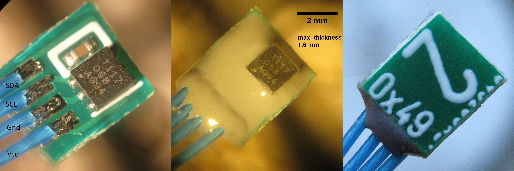
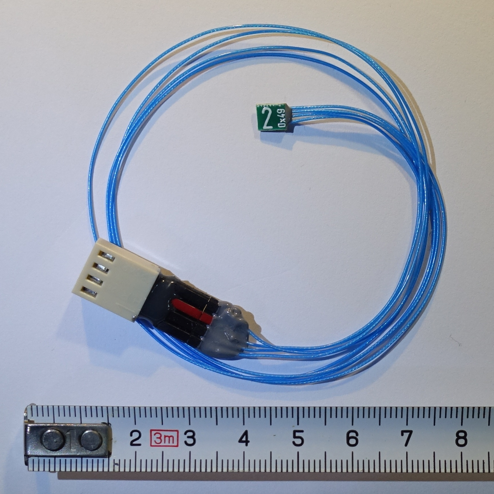
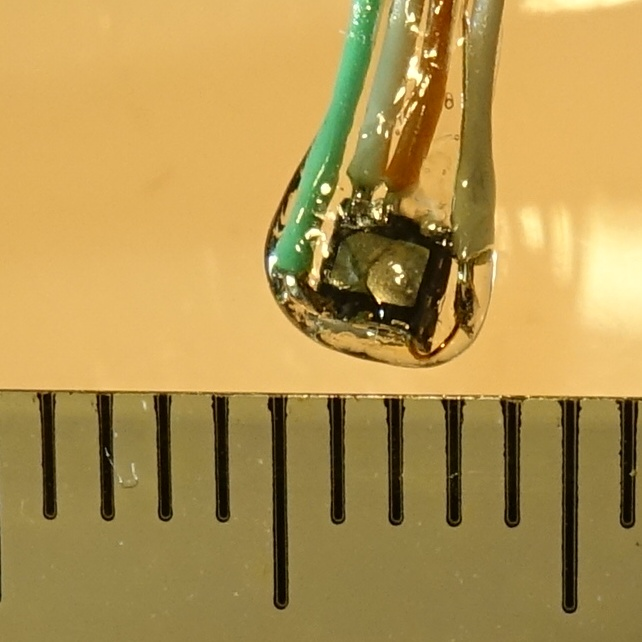
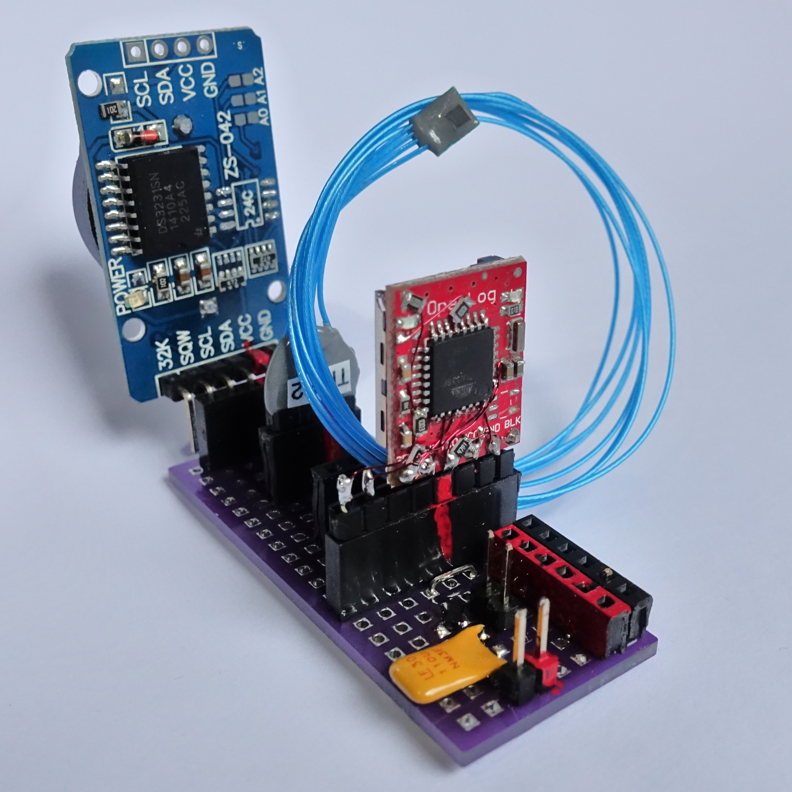
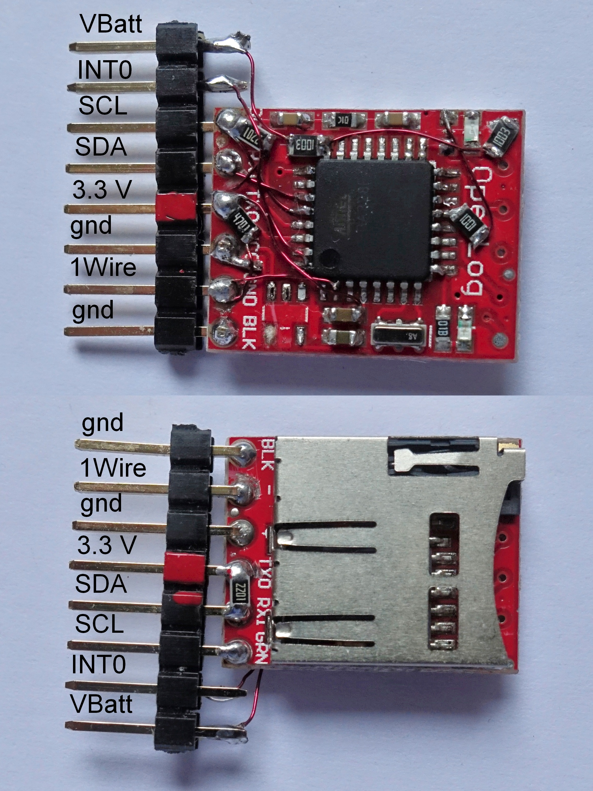
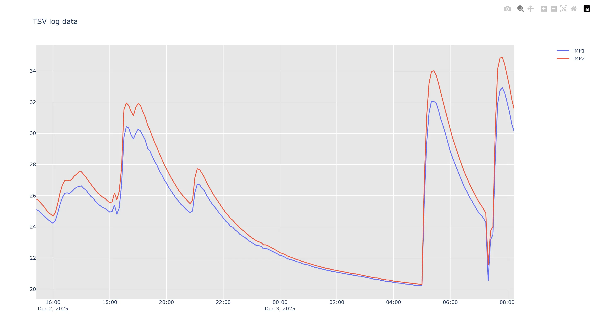
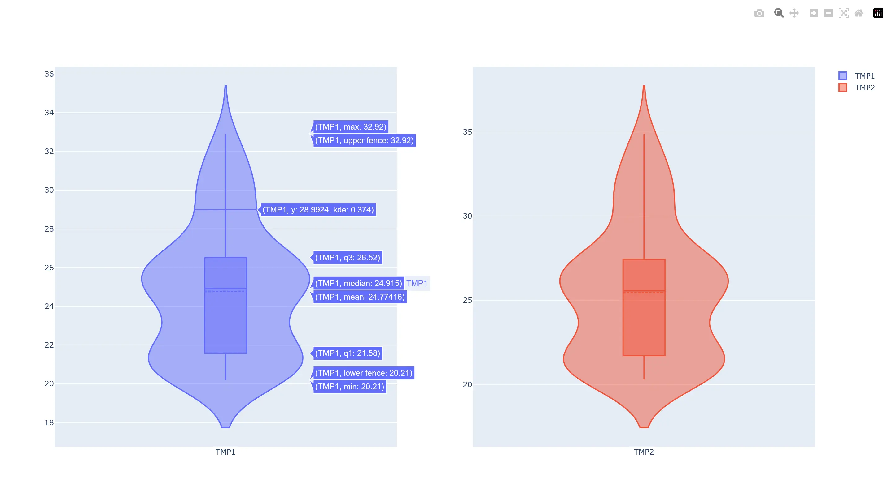

Highly accurate temperature logger for laboratory use
========================================================
**Logs data and timestamps directly to an SD card.** The package includes hardware design files, firmware, and a data analysis script. Our loggers have been reliably used in diverse laboratory applications for years. 

Features
--------

- **Logging data instantly** on startup, zero setup time

- **Automatically detecting** connected sensors

- Supports **multiple sensors** simultaneously

- Runs for **months** on a single 18650 Li-ion cell without recharging

- Up to four TMP117A sensors provide NIST-traceable 
**accuracy** not worse than **±0.1&nbsp;°C from –20&nbsp;°C to +50&nbsp;°C**.

- Writes a tab separated value formatted text file with 
**ISO 8601 date and time** to a micro-SD card. 
This format is compatible with python's pandas 
and plotly packages as well as with spreadsheet processing. 

- The user can **specify the logging interval in settings.txt** on the SD card. 

## What's Included

This repository contains the complete hardware, enclosure, and software files for a precision laboratory data logger:

* **Precision Temperature Firmware:** Arduino-compatible firmware designed for high-accuracy temperature logging using TMP117A sensors.
* **Extended Multi-Sensor Firmware:** An alternative firmware build that adds support for an extended temperature range, relative humidity, atmospheric pressure, non-contact infrared temperature, and illuminance (see *Supported Sensors* below).
* **Main Data Logger PCB:** Custom printed circuit board files integrating:
  * **Microcontroller:** Adafruit Feather 32u4 Adalogger (#2795)
  * **Real-Time Clock:** High-precision DS3231SN RTC
  * **Power:** Integrated 18650 lithium-ion battery holder
  * **On-Board Sensors:** Support for up to two TMP117A sensors for ambient monitoring in incubators or lab rooms
* **Remote Probe PCBs:** Four compact (**7 × 5 mm**) custom breakout boards designed for wire-attached TMP117A sensors. Ideal for direct contact probing in agar plates or liquid samples.
* **Enclosure CAD Files:** Production-ready `.step` (`.stp`) files defining the laser-cut acrylic/plastic panels required to assemble a protective housing for the electronics.

Comprises
-----------

- **Firmware** for precision temperature logging using TMP117A sensors

- A custom **printed circuit board** integrates an 18650 lithium-ion 
 battery, an accurate DS3231SN clock, the 'Adafruit Feather 32u4 Adalogger #2795' 
 and up to two on-board TMP117A sensors for environmental 
temperature monitoring in incubators or lab rooms.

- A production-ready STEP (.stp) file specifies the **laser-cut plastic components needed to assemble a protective casing** for the electronic hardware.

- Four **7 x 5 mm sized custom printed breakout circuit boards for wire-attached 
TMP117A sensors**. These act as probes in laboratory applications, 
for example, for usage in agar plates or liquid samples.

- An **alternative firmware supports sensor types for an extended temperature range, for logging
 humidity, atmospheric pressure, infrared non-contact temperature and illuminance**, see below. 

Notes
-----
1. On startup, the first three LED blinks **report the battery status**. Greed means 'good to go for at least a few days', red means that you have to charge before the next usage.

1. The number of LED blinks following the firt three blinks **reports the
   number of sensors detected.**

1. For measurements in **wet, salty or corrosive environments** you
must cover all exposed sensor board conductive surfaces with a high 
quality polyepoxide (cured epoxy resin).

2. The main printed circuit board must be coated for **water resistance** if used in humid conditions. 
We applied the acrylic protective lacquer "PLASTIK 70" from https://www.kontaktchemie.com to operate the device in a 2&nbsp;°C incubator. 

2. The logger can be **operated** at temperatures between **-20&nbsp;°C to +50&nbsp;°C**.

2. **Charging** must be done between **0&nbsp;°C to 45&nbsp;°C**, best at room temperature.

2. **Replace R0** on the Adafruit Feather 32u4 Adalogger 2795 with a 2.2k SMD resistor **for a 400 mA charging current**; otherwise, it defaults to 100 mA, taking four times longer to charge. 

2. TMP117 product versions **TMP117N and TMP117M are slightly 
less accurate** than TMP117A.

2. The **DS3231SN real-time clock may drift up to 63 seconds per year**.

2. The alternative **DS3231M real-time clock** version is less accurate but more vibration-resistant. It **may drift 
up to 158 seconds per year**.

2. SD card types vary widely in their standby current. For a longer battery life, 
**select an SD card with a low standby current**.

3. For a **quick-start** alternative to custom printed circuit boards and cases, you can build a logger by stacking an **Adafruit Feather 32u4 Adalogger (#2795)** with an **Adafruit DS3231 Precision RTC FeatherWing (#3028)** using male and female headers and a pluggable battery. This setup requires only basic header soldering to connect the two commercial components before uploading our firmware. While pluggable TMP117 breakout boards are commercially available (e.g., **Adafruit #4821** or **SparkFun #15805**), they are significantly larger than our custom sensor boards and harder to seal against wet and corrosive environments. You can also consider **Adafruit #6482**, which is a breakout board for the TMP119 (see below).

4. **SparkFun OpenLog (DEV-13712) compatibility**.
   Our firmware supports this board with advanced hardware modifications. The following steps require precise trace cutting and microscopic soldering, ideally performed by an electronics technician:
   * Flash the firmware via an ISP programmer
   * Break out the I2C-bus and INT0
   * Re-wire one LED
   * Add pull-up resistors for I2C and 1-Wire bus
   * Add a voltage divider for battery monitoring
   * Integrate a DS3231 RTC and TMP117 sensors 

5. To meet **alternative research requirements**, we offer a specialized firmware version that supports a wider range of sensor types:
    * TMP117 and TMP119 (accuracy not worse than ±0.1&nbsp;°C from –20&nbsp;°C to +50&nbsp;°C, NIST-traceable)
    * ADT7420 (±0.20 °C accuracy from −10°C to +85 °C, NIST-traceable)		
    * 1-Wire temperature, this allows for a larger number of sensors on a several meters long two-conductor cable
      * DS18B20 (±0.5 °C accuracy from -10°C to +85 °C)
      * DS18S20 (±0.5 °C accuracy from -10°C to +85 °C, obsolete)
      * MAX31850 for type K thermocouples allows measurements from -30 °C to +600 °C. The optional correction according to the ITS-90 standard extends this range from -200 °C to +1200 °C.

    * BME280 (humidity, atmospheric pressure, less accurate temperature)

    * MLX90614 (infrared non-contact temperature)

    * TSL2561 (illuminance)
	

    This firmware is more complex and requires you to select sensors by uncommenting "#define" statements in the C source code. While different sensor types can be mixed, memory limitations mean that only certain combinations of options can be joined in one firmware version. **The firmware then automatically discovers the connected sensors on startup.**
> ⚠️ **Tip:** If you need more than four temperature sensors, use 1-Wire models.

13. You may like to try the newer and software compatible sensor type TMP119.
**TMP119 has a higher accuracy(±0.03&nbsp;°C (typical) from 0&nbsp;°C to 45&nbsp;°C**
and ±0.08&nbsp;°C (maximum) from 0&nbsp;°C to 45&nbsp;°C), but is only available in the 
YBG0006 'Die Size Ball Grid Array' package, which doesn't match our boards layout.
Remarkably, the die size of TMP119 is just 1.5&nbsp;mm x 1.0&nbsp;mm. This allows laboratory applications,
for which the 2.1&nbsp;mm x 2.1&nbsp;mm sized WSON package size is too large. A breakout board is available as 
Adafruit #6482, or, as https://www.pcbway.com/project/shareproject/[FPCB_version]_Precision_thermometer_humidity_sensor_with_digital_I2C_interfac_736a557b.html.

User manual
-------------
Read `Intructions_for_temperature_logger_usage.pdf`

Contributions
-------------

This device was developed by the department of Bioinformatics and Molecular Genetics
('The Baumeister Lab'), Institute for Biology III, Faculty of Biology, 
University of Freiburg, Schänzlestraße 1, 79104 Freiburg, Germany
in collaboration with the institute's electronics workshop 'AT-Technik'.
The hardware was designed by Jürgen Schmidt and constructed by 
Joshua Schwarber. Jürgen Schmidt wrote an initial low-power voltage 
and temperature logging firmware, which was extended to the present highly accurate temperature 
logging firmware by Ekkehard Schulze. Ekkehard Schulze tested 
various temperature sensors types and identified the 
Texas Instruments sensor TMP117A as the only type satisfying 
our experimental requirements in the temperature range close to 0&nbsp;°C.

Images
-------

**TMP117A sensor board before and after coating with epoxy resin**
\
\
\

**Sensor board with polytetrafluoroethylene isolated wires and plug**
\
\
\

**Logger with external sensor attached** via cable. A further sensor is present on the main board. The scale is cm/mm.
\
\
\

**TMP117A sensor soldered to wires and coated with polymerized cyanoacrylate** after years of lab use. This mounting
was performed to minimize the size of the probe. Avoid outdoor use of cyanoacrylate polymer coated sensors; enduring UV light 
deteriorates it. The scale is mm.
\
\
\

**Adaption of an Openlog board** (SparkFun DEV-13712) for highly accurate temperature logging using an improvised  I2C-bus board and a DS3231 clock module (ZS-042). LED, EEPROM and the battery charging circuit were removed from the clock board for power optimization. **This setup represents the most budget-friendly hardware configuration** supported by the firmware. 
 To build the binary for this hardware, ensure `#define OPENLOG` is active and `#define ADAFRUIT_FEATHER_LOGGER` is commented out in the C source file.
\
\
\

However, adaption of an Openlog board for this firmware requires advanced hardware modifications. See point 11 in the __Notes__ section above.
\
\
\

Screenshots of **interactive data analysis** using the script "plot_and_analyze_time_series.py".
